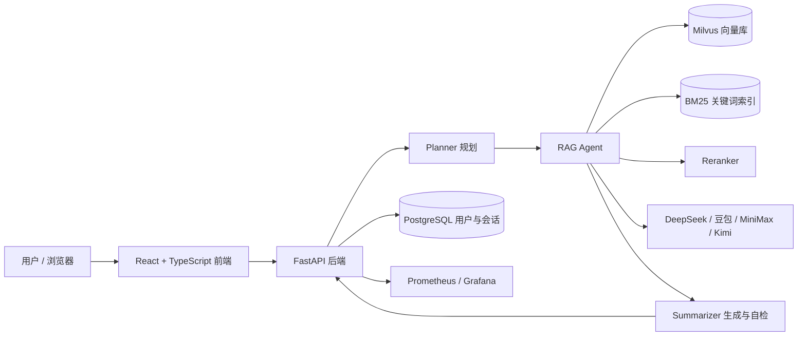

# OmniPilot 面向银行业监管制度与统计报表的可信 RAG 问答系统

面向银行业监管制度与统计报表的**可信 RAG 问答系统**。基于 LangGraph 多智能体协作框架，集成 Milvus 向量检索、BM25 关键词检索、RRF 融合与 Reranker 重排序，支持 Word / Excel / PDF 多源异构文档的精准检索、跨文件多跳推理与可验证问答。


---

## 评测结果（300 题）

> 评测时间：2026-10-25 · 300 题均衡测试集 · 端到端真实调用（非离线模拟）

| 指标 | 结果 |
|------|------|
| **整体准确率** | **298 / 300 = 99.33%** |
| 解析失败 / API 错误 | 0 / 0 |
| **Recall@5** | **284 / 300 = 94.67%** |
| **MRR@10** | **0.9467** |
| P50 / P95 端到端延迟 | 27.35s / 72.75s |
| 首 token P50 / P95 | 2.33s / 3.43s |
| 平均端到端延迟 | 35.98s |
| 总耗时 | 179.9 min |
| 总 Token | 2,702,698 input / 859,632 output |
| 总成本 / 单题成本 | ¥3.3691 / ¥0.011230 |

**分难度准确率**

| 难度 | 题数 | 答对 | 准确率 |
|------|:----:|:----:|:------:|
| easy | 102 | 101 | 99.02% |
| medium | 99 | 98 | 98.99% |
| hard | 99 | 99 | 100.00% |

**分文档类型准确率**

| 类型 | 题数 | 答对 | 准确率 |
|------|:----:|:----:|:------:|
| Word | 100 | 99 | 99.00% |
| PDF | 100 | 100 | 100.00% |
| Excel | 100 | 99 | 99.00% |

**错题分析**

| 题目 | 难度 / 类型 | 期望 | 实际 | 检索是否命中 |
|------|-------------|:----:|:----:|:------------:|
| Q019 | easy / Excel | C | A | ✅ gold 在 Top-5 |
| Q162 | medium / Word | D | X（拒答） | ✅ gold 在 Top-5 |

两题的错误都发生在“检索已命中、生成/判断阶段”，说明当前主要误差来源不是召回，而是表格读数与个别条款的选项判别。该结论可用于后续优化 Reranker 阈值、表格数值校验和二次自检。

**复现方式**

```bash
python valuation/evaluate_all.py --start 0 --end 300
```

- 评测模型：DeepSeek（由 `.env` 的 `LLM_MODEL` 指定，默认 `deepseek-v4-flash`）
- 嵌入模型：`Qwen/Qwen3-Embedding-0.6B`
- 温度：`0.0`
- 结果写入 `valuation/reports/test_300_result.json` 与 `test_300_report.md`（该目录默认不入库，需本地重新生成）
- 结果会随模型版本、API Key 配额、机器性能与 Milvus 索引状态变化，建议在相同配置下对比

---

## 核心功能

| 功能 | 说明 |
|------|------|
| 多源文档解析 | Word 章节层级、Excel 表头检测与行列切分、PDF 文本 + OCR |
| 混合检索 | Milvus 向量 + BM25 关键词 + RRF 融合 + Reranker 重排序 |
| 元数据过滤 | 文件名、年份、发文机关、指标、时间维度、条款号等多字段过滤 |
| 多跳推理 | Planner 问题拆分与子任务规划，跨文件证据聚合 |
| 反幻觉 | 文档来源校验、OOKB 拒答、约束生成 |
| 多模型切换 | DeepSeek / 豆包 / MiniMax / Kimi / 自定义提供商 |
| 用户与权限 | JWT 认证 + 管理员 / 普通用户角色 |
| 可视化评测 | 前端批量测试面板 + 命令行 300 题评测脚本 |
| 可观测性 | Prometheus 指标 + Grafana 面板 |

---

## 系统架构



---

## 环境要求

| 组件 | 版本 | 说明 |
|------|------|------|
| Python | **3.10 / 3.11** | 后端运行环境；`pandas==1.5.3` 在 3.12+ 无预编译包，不建议使用 |
| Node.js | ≥ 18 | 前端构建；已在 Node 24 下验证 |
| Docker | ≥ 24 | 一键部署基础设施与服务 |
| Docker Compose | v2 | 使用 `docker compose`，不再使用旧的 `docker-compose` |
| 内存 / 磁盘 | 8 GB+ / 10 GB+ | Milvus、镜像与知识库索引需要空间 |
| Tesseract OCR | ≥ 5.0 | 可选；PDF 中文 OCR 需要 `chi_sim` |
| LibreOffice | ≥ 7.0 | 可选；解析 `.doc` 老格式，Docker 镜像内已安装 |
| Microsoft Word + pywin32 | — | 可选；Windows 下转换 `.doc` 的另一种方式 |

> 如果本机是 Python 3.12 / 3.13，建议直接用 Docker 方式，或在 3.10 / 3.11 虚拟环境中安装依赖。

---

## 快速开始

### 方式一：Docker 一键部署（推荐）

**0. 前置**

- 安装并启动 Docker Desktop（Windows / macOS）或 Docker Engine（Linux）
- 国内网络建议先配置镜像加速：Docker Desktop → Settings → Docker Engine，加入：

```json
{
  "registry-mirrors": [
    "https://docker.m.daocloud.io",
    "https://hub-mirror.c.163.com",
    "https://mirror.baidubce.com"
  ]
}
```

**1. 克隆并配置**

```bash
git clone https://github.com/WQNF/rag-ominipilot-system.git
cd rag-ominipilot-system
```

Windows PowerShell：

```powershell
Copy-Item .env.example .env
notepad .env
```

macOS / Linux：

```bash
cp .env.example .env
```

至少填写：

```dotenv
SILICON_FLOW_API_KEY=你的硅基流动密钥   # 必填：向量嵌入
deepseek_API_KEY=你的DeepSeek密钥      # 必填：默认 LLM
JWT_SECRET_KEY=至少32位随机字符串       # 强烈建议修改
```

**2. 启动全部服务**

```bash
docker compose -f docker/docker-compose.yml up -d --build
docker compose -f docker/docker-compose.yml ps
```

首次构建会安装 LibreOffice、Tesseract、中文字体并打包 500 份文档，通常需要 10–20 分钟。`postgres` 显示 `healthy`、`milvus` / `backend` 为 `running` 后再继续。

**3. 初始化数据库与知识库（在 backend 容器内执行）**

```bash
docker compose -f docker/docker-compose.yml exec backend python tools/init_db.py
docker compose -f docker/docker-compose.yml exec backend python tools/init_milvus.py --mode all
```

- `--mode all` 依次构建 Word、PDF、Excel 知识库，首次约 **3 小时**（Excel 约 10.9 万块，主要耗时在嵌入 API）
- 只想先跑通问答，可只建 Word：`--mode word`；之后再补 `--mode pdf`、`--mode excel`
- 初始化期间请保持终端连接；中断后重新执行即可（脚本按文件清理旧块，不会重复堆积）

**4. 访问**

| 服务 | 地址 |
|------|------|
| 前端 | http://localhost |
| 后端 API 文档 | http://localhost:8000/docs |
| Prometheus | http://localhost:9090 |
| Grafana | http://localhost:3000（默认 admin / admin） |

默认账号（首次登录后请修改密码）：

| 角色 | 用户名 | 密码 |
|------|--------|------|
| 管理员 | `admin` | `admin123` |
| 普通用户 | `zhangwei` | `secret123` |

**常用 Docker 命令**

```bash
# 查看日志
docker compose -f docker/docker-compose.yml logs -f backend

# 改代码后重建后端
docker compose -f docker/docker-compose.yml up -d --build backend

# 停止（保留数据卷）
docker compose -f docker/docker-compose.yml down

# 停止并清空数据库 / Milvus 数据（谨慎）
docker compose -f docker/docker-compose.yml down -v
```

> Docker 模式与下面的本地开发模式**不要同时启动**，否则 8000 端口会冲突。

---

### 方式二：本地开发

**1. 创建 Python 环境（3.10 / 3.11）**

Windows PowerShell：

```powershell
python -m venv .venv
.\.venv\Scripts\Activate.ps1
python -m pip install --upgrade pip
pip install -r requirements.txt
```

macOS / Linux：

```bash
python3 -m venv .venv
source .venv/bin/activate
python -m pip install --upgrade pip
pip install -r requirements.txt
```

**2. 配置 `.env`**

```powershell
Copy-Item .env.example .env
notepad .env
```

macOS / Linux 使用 `cp .env.example .env`。

**3. 只启动基础设施**

```bash
docker compose -f docker/docker-compose.yml up -d postgres etcd minio milvus
```

此时 PostgreSQL 暴露在 `localhost:5432`，Milvus 暴露在 `localhost:19530`，与 `.env` 默认值一致。

**4. 初始化数据库与知识库**

```bash
python tools/init_db.py
python tools/init_milvus.py --mode all
```

**5. 启动后端**

```bash
uvicorn api.main:app --host 0.0.0.0 --port 8000 --reload
```

**6. 新开终端，启动前端**

```bash
cd frontend-react
npm install
npm run dev
```

访问 **http://localhost:5173**。Vite 已代理 `/token`、`/chat`、`/files`、`/register`、`/admin`、`/settings`、`/knowledge`、`/test`、`/users`、`/metrics` 到 `127.0.0.1:8000`。

> 如果修改了 `vite.config.ts`，需要重启 `npm run dev` 才会生效。

---

## 配置说明

`.env` 已被 `.gitignore` 排除，请勿提交真实密钥。

| 变量 | 必填 | 说明 |
|------|:----:|------|
| `SILICON_FLOW_API_KEY` | 是 | 硅基流动密钥，用于文档嵌入 |
| `SILICON_FLOW_API_BASE` | 否 | 默认 `https://api.siliconflow.cn/v1` |
| `EMBEDDING_MODEL` | 否 | 默认 `Qwen/Qwen3-Embedding-0.6B` |
| `deepseek_API_KEY` | 是 | 默认 LLM 密钥 |
| `deepseek_API_BASE` | 否 | 默认 `https://api.deepseek.com` |
| `LLM_MODEL` | 否 | 默认 `deepseek-v4-flash` |
| `JWT_SECRET_KEY` | 建议 | JWT 签名密钥，生产环境务必改成 32 位以上随机串 |
| `MILVUS_HOST` / `MILVUS_PORT` | 否 | 本地默认 `localhost:19530`；Docker 内由 Compose 覆盖为 `milvus:19530` |
| `POSTGRES_HOST` / `POSTGRES_PORT` | 否 | 本地默认 `localhost:5432`；Docker 内由 Compose 覆盖为 `postgres:5432` |
| `POSTGRES_USER` / `PASSWORD` / `DB` | 否 | 默认 `omnipilot` / `omnipilot123` / `omnipilot` |
| `RETRIEVAL_TOP_K` | 否 | 默认 80 |
| `RETRIEVAL_NPROBE` | 否 | 默认 16 |
| `RETRIEVAL_THRESHOLD` | 否 | 默认 0.3 |
| `LLM_TEMPERATURE` | 否 | 默认 0.0 |
| `PDF_OCR_IMAGES` / `PDF_OCR_FULL_PAGE` | 否 | 默认 `true`；不需要 OCR 时设为 `false` 可明显提速 |
| `PDF_OCR_LANG` | 否 | 默认 `chi_sim+eng` |
| `TESSERACT_CMD` | 否 | `tesseract` 不在 PATH 时填写绝对路径 |
| `LIBREOFFICE_PATH` | 否 | `soffice` 不在默认路径时填写绝对路径 |
| `xiaomi_API_KEY` / `xiaomi_API_BASE` | 否 | 可选提供商 |

**模型提供商**

| 提供商 | API Base | 示例模型 |
|--------|----------|----------|
| DeepSeek | `https://api.deepseek.com` | `deepseek-v4-flash` / `deepseek-v4-pro` |
| 豆包（Doubao） | `https://ark.cn-beijing.volces.com/api/v3` | `doubao-seed-evolving` 等 |
| MiniMax | `https://api.minimaxi.com/anthropic` | `MiniMax-M2.7` 等 |
| Kimi | `https://api.moonshot.cn/v1` | `kimi-k2.7-code-highspeed` 等 |
| 自定义 | 任意 OpenAI 兼容地址 | 自行填写 |

密钥获取入口：

- DeepSeek：https://platform.deepseek.com
- 硅基流动：https://www.siliconflow.cn
- 火山方舟（豆包）：https://console.volcengine.com/ark
- MiniMax：https://platform.minimaxi.com
- Moonshot（Kimi）：https://platform.moonshot.cn

---

## 数据与知识库

| 类型 | 文件数 | 说明 |
|------|:------:|------|
| Excel | 389 | 监管统计报表（`.xls` / `.xlsx`） |
| PDF | 45 | 监管制度、年报、附件 |
| Word | 66 | 32 份 `.doc` + 34 份 `.docx` |
| **合计** | **500** | 首次全量嵌入约 3 小时 |

- Word 约 1,200 个知识块，PDF 约 1,000 个，Excel 约 10.9 万个
- 知识库重建：`python tools/init_milvus.py --mode word|pdf|excel|all`
- `bm25_index.pkl` 首次查询时自动构建，文件约 200 MB，已加入 `.gitignore`
- 删除某类旧数据后重建即可，不会影响其他类型；重建会先按文件名删除旧块

**`.doc` 老格式**

代码会自动把 `.doc` 转成临时 `.docx` 再解析：

1. Windows 且安装了 Word：`pip install pywin32`（未包含在 `requirements.txt`）
2. 否则安装 LibreOffice，并在 `.env` 设置 `LIBREOFFICE_PATH`（Docker 镜像已内置 `libreoffice-writer`）

**OCR 说明**

- Docker 镜像已安装 `tesseract-ocr`、`tesseract-ocr-chi-sim`、`tesseract-ocr-chi-tra`
- Windows 仓库内置 `OCR/tesseract.exe`，但 `OCR/tessdata` 只有 `eng` 与 `osd`；中文 OCR 需额外把 `chi_sim.traineddata` 放入 `OCR/tessdata/`，并设置：

```dotenv
TESSERACT_CMD=D:\你的路径\大赛项目最终版\OCR\tesseract.exe
```

- 不需要 OCR 时，将 `PDF_OCR_IMAGES=false`、`PDF_OCR_FULL_PAGE=false` 可显著缩短建库时间
- Word 初始化时出现少量 OCR 失败日志属于正常现象（Word 解析不依赖 OCR）

---

## 功能使用说明

### 1. 登录与注册

系统内置默认账号，无需注册即可登录；也可注册新账号。

| 角色 | 用户名 | 密码 | 权限 |
|------|--------|------|------|
| 管理员 | `admin` | `admin123` | 用户管理 + 全部功能 |
| 普通用户 | `zhangwei` | `secret123` | 问答 + 知识库管理 |

- **登录**：输入用户名和密码，获取 JWT Token
- **注册**：用户名、密码（≥ 6 位且不能为纯数字），可选姓名、部门、邮箱
- **退出**：侧边栏底部退出按钮

### 2. 对话问答

- **发起提问**：底部输入框，按 Enter 发送
- **流式响应**：思考过程、答案正文、来源引用、耗时统计
- **来源引用**：标注文件名、页码、章节、检索分数，可展开原文预览
- **文档筛选**：侧边栏勾选知识库文档，问答仅检索选定范围
- **会话统计**：顶部显示知识库文档数量与更新时间

### 3. 会话管理

- 新建、重命名（右键 / 双击）、删除、置顶
- 自动按时间分组：置顶 / 今天 / 7 天内 / 更早
- 会话保存在本地，刷新不丢失

### 4. 知识库管理

- **公共知识库**：所有用户共享，按 Word / PDF / Excel 分类
- **个人知识库**：仅本人可见，支持上传、删除、下载
- **文档筛选**：勾选后问答仅检索选中文档；标签可单个移除或全部清除

### 5. 模型切换

顶部模型选择器可一键切换提供商，切换后立即生效，无需刷新。

### 6. LLM 参数设置

侧边栏设置面板支持：

- 提供商 / 模型选择（含自定义模型名）
- 各提供商独立 API Key
- 温度 0.0–2.0
- Top-K、nprobe、相似度阈值

### 7. 批量测试

- 从下拉列表选择 `data/test_dataset/` 下的数据集
- 实时进度、当前题目 ID
- 支持停止 / 从中断点继续
- 测试历史：数据集、时间、进度、正确 / 错误 / 异常数

### 8. 管理员用户管理

仅管理员可见：用户列表、新增、编辑（密码 / 角色 / 姓名 / 部门 / 邮箱 / 激活状态）、删除。

### 9. 主题切换

顶部 🌙 / ☀️ 按钮切换亮色 / 暗色模式，偏好自动保存。

---

## 项目结构

```text
├── agents/                 # Planner / Dispatcher / RAG / Summarizer
├── api/                    # FastAPI 后端、JWT 认证、用户管理
│   └── dependencies/
├── config/                 # Prompt 模板与文档配置
├── core/                   # LangGraph 工作流、LLM 客户端、状态管理
├── data/                   # 知识库文档（excel / word / pdf，共 500 份）
│   ├── excel/
│   ├── pdf/
│   ├── word/
│   │   ├── doc/            # .doc 老格式
│   │   └── docx/
│   ├── test_dataset/       # 300 题测试集与分难度子集
│   └── test_outside_dataset/  # 拒答题测试集
├── docker/                 # Docker Compose（PostgreSQL + Milvus + 监控）
├── frontend-react/         # React + TypeScript + Vite 前端
├── nginx/                  # 生产环境反向代理配置
├── OCR/                    # Windows 内置 Tesseract（可选）
├── skills/                 # 扩展技能占位
├── tools/                  # 解析、检索、嵌入、重排序、初始化脚本
├── valuation/              # 评测脚本；reports/ 为本地生成结果
├── Dockerfile              # 后端镜像
├── requirements.txt        # Python 依赖
└── readme.md
```

---

## API 接口

| 端点 | 方法 | 说明 |
|------|------|------|
| `/chat` | POST | 非流式问答 |
| `/chat/stream` | POST | 流式问答（SSE，需登录） |
| `/token` | POST | 用户登录 |
| `/register` | POST | 用户注册 |
| `/users/me` | GET | 当前用户信息 |
| `/settings` | GET/POST | LLM 配置管理 |
| `/admin/users` | GET/POST | 用户列表 / 新增用户 |
| `/admin/users/{username}` | PUT/DELETE | 编辑 / 删除用户 |
| `/knowledge/docs` | GET | 公共知识库文档列表 |
| `/knowledge/upload` | POST | 上传文档到公共知识库 |
| `/knowledge/personal/docs` | GET | 个人知识库文档列表 |
| `/knowledge/personal/upload` | POST | 上传文档到个人知识库 |
| `/knowledge/personal/docs/{document_id}` | DELETE | 删除个人文档 |
| `/knowledge/personal/docs/{document_id}/file` | GET | 下载个人文档 |
| `/knowledge/stats` | GET | 知识库统计 |
| `/files/{file_path:path}` | GET | 文件下载 / 静态资源 |
| `/test/datasets` | GET | 测试数据集列表 |
| `/test/run` | POST | 批量测试（实时进度） |
| `/test/stop` | POST | 停止测试 |
| `/metrics` | GET | Prometheus 监控指标 |

---

## 常见问题

**Q1：Docker 启动后登录失败 / 后端连接不上数据库或 Milvus**

先确认容器状态：

```bash
docker compose -f docker/docker-compose.yml ps
docker compose -f docker/docker-compose.yml logs --tail=100 backend
```

Compose 已为 backend 注入 `MILVUS_HOST=milvus`、`POSTGRES_HOST=postgres`。如果手动改过 `.env`，不要在里面把这两个值改回 `localhost`。

**Q2：`pip install -r requirements.txt` 在 Windows 失败**

- 确认 Python 是 3.10 / 3.11，不要用 3.12+
- `psycopg2` 已替换为 `psycopg2-binary`，无需本地 PostgreSQL 开发包
- 如果仍失败，单独执行 `pip install psycopg2-binary==2.9.12`

**Q3：`init_milvus.py --mode all` 太慢或中途断开**

- 全量约 3 小时，建议分类型执行：`--mode word` → `--mode pdf` → `--mode excel`
- 确认 `SILICON_FLOW_API_KEY` 有余额；429 限流时脚本会自动退避重试
- 中断后重新执行即可，已完成的文件会先删旧块再写入

**Q4：PDF 中文 OCR 不生效**

- Docker 镜像已带 `chi_sim`；本地 Windows 需把 `chi_sim.traineddata` 放到 `OCR/tessdata/`
- 在 `.env` 设置 `TESSERACT_CMD` 指向 `tesseract.exe` 绝对路径
- 扫描版 PDF 才需要 OCR；普通文本 PDF 可关闭 OCR 提速

**Q5：`.doc` 解析失败**

- Windows：安装 Word 后 `pip install pywin32`，或安装 LibreOffice
- Linux / Docker：安装 `libreoffice-writer`；Docker 镜像已内置
- 设置 `LIBREOFFICE_PATH` 指向 `soffice.exe`

**Q6：`npm run dev` 打开后知识库 / 测试页面 404**

Vite 代理已补齐 `/knowledge`、`/test`、`/users`、`/metrics`。如果你是在修改配置前启动的，重启 `npm run dev` 即可。

**Q7：端口被占用**

| 端口 | 服务 |
|------|------|
| 80 | Docker 前端 |
| 8000 | 后端 |
| 5173 | Vite 开发服务器 |
| 5432 | PostgreSQL |
| 19530 / 9091 | Milvus |
| 9090 | Prometheus |
| 3000 | Grafana |

前端 80 被占用时，可把 compose 中的 `"80:80"` 改为 `"8080:80"`，然后访问 http://localhost:8080。

**Q8：Docker 内存不足 / Milvus 反复重启**

Milvus 建议至少分配 4 GB 内存，整机建议 8 GB+。在 Docker Desktop → Resources 中调高内存后重启。

---

## 安全与合规

- `.env`、`bm25_index.pkl`、`valuation/reports/`、`api/user_settings.json`、`data/conversations.json` 均已加入 `.gitignore`，不要提交真实密钥或用户数据
- 生产环境务必修改默认账号密码和 `JWT_SECRET_KEY`
- 设置面板中的 API Key 保存在本地 `api/user_settings.json`（已忽略），请勿打包分发
- 仓库中的示例文档来自公开监管制度与统计报表；如替换为内部数据，请先完成脱敏并确认授权
- 对外部署时建议在 Nginx 层增加 HTTPS、访问控制与速率限制

---

## 致谢

- [LangGraph](https://github.com/langchain-ai/langgraph) / [LangChain](https://github.com/langchain-ai/langchain)
- [Milvus](https://milvus.io/) / [PyMilvus](https://github.com/milvus-io/pymilvus)
- [FastAPI](https://fastapi.tiangolo.com/) / [React](https://react.dev/) / [Vite](https://vitejs.dev/)
- [Tesseract OCR](https://github.com/tesseract-ocr/tesseract) / [LibreOffice](https://www.libreoffice.org/)
